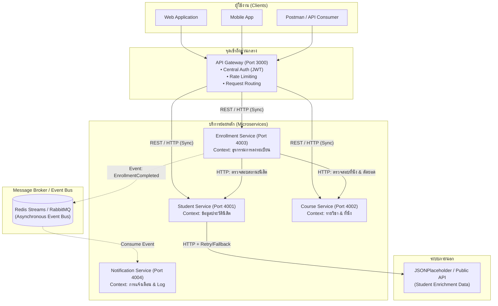

# ออกแบบสถาปัตยกรรม Microservices ของระบบ Student & Course Registration System

เอกสารฉบับนี้จัดทำขึ้นตามข้อกำหนดของปฏิบัติการสัปดาห์ที่ 13 โดยประยุกต์ใช้แนวคิด **Domain-Driven Design (DDD)** และ **Bounded Context** เพื่อแบ่งระบบ Monolithic ของระบบบริหารจัดการข้อมูลนิสิตและการลงทะเบียนเรียน ออกเป็นบริการย่อย (Microservices) ที่เป็นอิสระต่อกัน ทั้งในด้าน Business Logic ฐานข้อมูล และการ Deploy

---

## 1. การแบ่งบริการตาม Bounded Context

การแบ่งขอบเขตความรับผิดชอบของระบบแบ่งออกเป็น 4 บริการย่อยหลัก โดยแต่ละบริการมีฐานข้อมูลของตนเอง (Database-per-Service Pattern) เพื่อลดการผูกมัด (Loose Coupling):

| บริการ (Service) | พอร์ตจำลอง | ความรับผิดชอบ (Bounded Context) | Database | Endpoint หลัก |
| :--- | :---: | :--- | :--- | :--- |
| **API Gateway** | `3000` | • ศูนย์กลางรับ Request จาก Client ทั้งหมด (Reverse Proxy) • ตรวจสอบสิทธิ์ (Centralized JWT Authentication) • ป้องกันการโจมตี (Global & Endpoint Rate Limiting) • Routing คำขอไปยังบริการปลายทาง | - | `ANY /api/v1/*` |
| **Student Service** | `4001` | • จัดการประวัติ ข้อมูลส่วนบุคคล และสถานะของนิสิต • เชื่อมต่อ External API เพื่อดึงข้อมูลเสริม (Enrichment) • ตรวจสอบความถูกต้องของข้อมูลนิสิต (Zod Validation) | `student_db` | • `GET /students` • `GET /students/:id` • `POST /students` • `PUT /students/:id` • `GET /students/:id/enrichment` |
| **Course Service** | `4002` | • จัดการรายวิชา หลักสูตร จำนวนหน่วยกิต • ควบคุมโควตาที่นั่งในแต่ละกลุ่มเรียน (Seat Availability) • จัดการข้อมูลอาจารย์ผู้สอนและตารางเรียน | `course_db` | • `GET /courses` • `GET /courses/:id` • `POST /courses` • `PATCH /courses/:id/seats` |
| **Enrollment Service** | `4003` | • ประมวลผลการลงทะเบียนเรียน (Registration Transaction) • ตรวจสอบเงื่อนไขการลงทะเบียนซ้ำ และที่นั่งคงเหลือ • จัดการประวัติการลงทะเบียนและถอนรายวิชา | `enrollment_db` | • `POST /enrollments` • `GET /enrollments/student/:id` • `DELETE /enrollments/:id` |
| **Notification Service** | `4004` | • ส่งอีเมล/การแจ้งเตือนยืนยันผลการลงทะเบียน • ส่งแจ้งเตือนเมื่อเกิดข้อผิดพลาดหรือมีการเปลี่ยนแปลงตารางสอน | `notification_db` | • `POST /notifications/send` • `GET /notifications/user/:userId` |

---

## 2. แผนภาพสถาปัตยกรรม (Architecture Diagram)

แผนภาพแสดงสถาปัตยกรรมโดยรวม ทิศทางการเรียกคำขอ และรูปแบบการสื่อสารระหว่างบริการ:

---

## 3. รูปแบบการสื่อสารระหว่างบริการ (Communication Patterns)

| จากบริการ (Source) | ไปยังบริการ (Target) | รูปแบบการสื่อสาร | โปรโตคอล / เทคโนโลยี | เหตุผลประกอบการออกแบบ |
| :--- | :--- | :---: | :---: | :--- |
| **Client** | **API Gateway** | Synchronous | HTTPS / JSON REST | ไคลเอนต์ต้องการผลลัพธ์ทันทีเพื่อแสดงผลบนหน้าจอ |
| **API Gateway** | **Student Service** | Synchronous | HTTP / REST | จำเป็นต้องรอข้อมูลประวัตินิสิตเพื่อส่งกลับไปยังผู้ใช้ทันที |
| **API Gateway** | **Course Service** | Synchronous | HTTP / REST | ต้องการข้อมูลรายชื่อและรายละเอียดวิชาแบบ Real-time |
| **API Gateway** | **Enrollment Service** | Synchronous | HTTP / REST | ผู้ใช้งานต้องการทราบผลการกดลงทะเบียนเรียนทันที |
| **Enrollment Service** | **Course Service** | Synchronous | HTTP / REST (พร้อม Timeout) | ต้องตรวจสอบจำนวนที่นั่งคงเหลือและจองที่นั่งแบบทันที เพื่อป้องกันที่นั่งเกิน (Oversubscription) |
| **Enrollment Service** | **Notification Service** | **Asynchronous** | Message Queue (RabbitMQ / Redis) | การส่งอีเมลแจ้งเตือนใช้เวลานานและไม่จำเป็นต้องบล็อกการลงทะเบียน การใช้ Event-Driven ช่วยให้ระบบลงทะเบียนตอบสนองได้รวดเร็ว |
| **Student Service** | **External Public API** | Synchronous | HTTPS (Axios) | ดึงข้อมูลเสริมเฉพาะเมื่อมีคำขอเรียกเข้ามา |

---

## 4. จุดที่ต้องมีกลไก Resilience (Retry / Timeout / Fallback)

เมื่อแยกเป็น Microservices การสื่อสารผ่านเครือข่ายอาจเกิดความล้มเหลวชั่วคราว (Network Flaky, Latency, Service Down) จึงต้องมีกลไกตามหลักสัปดาห์ที่ 11 ดังนี้:

| บริการต้นทาง | บริการปลายทาง | กลไก Resilience ที่ต้องมี | ค่าที่กำหนด | เหตุผลความจำเป็น |
| :--- | :--- | :---: | :---: | :--- |
| **API Gateway** | **ทุกบริการย่อย** | • **Timeout** • **Fallback Response** (503) | Timeout: 3,000 ms | ป้องกันไม่ให้ Gateway ค้างเมื่อบริการปลายทางล่ม หรือมี latency สูง ตอบกลับด้วย 503 Service Unavailable อย่างสุภาพ |
| **Student Service** | **External Public API** | • **Timeout** • **Retry with Exponential Backoff & Equal Jitter** • **Graceful Fallback** | Timeout: 3,000 ms Max Retries: 2 ครั้ง Backoff: $2^{(\text{att}-1)} \times 1\text{s} + \text{jitter}$ | ป้องกันความไม่แน่นอนของ Third-party API ภายนอก หากล้มเหลวให้ใช้ค่า Fallback เพื่อให้ Response หลักยังส่งกลับได้สำเร็จ (200 OK) |
| **Enrollment Service** | **Course Service** | • **Short Timeout** • **Circuit Breaker** • **No Auto-Retry on Mutation** | Timeout: 2,000 ms Circuit Breaker: Error > 50% | การตัดที่นั่งเป็นคำสั่งที่มีผลต่อสถานะข้อมูล (Mutation) ห้าม retry อัตโนมัติหากไม่แน่ใจว่าปลายทางประมวลผลไปแล้วหรือไม่ (Idempotency Risk) ต้องตัด timeout สั้นและคืนข้อความให้ผู้ใช้ลองใหม่ |
| **Notification Service** | **Email Provider (SMTP)** | • **Retry with Dead Letter Queue (DLQ)** | Max Retries: 3 ครั้ง DLQ หลังจากล้มเหลว | เมื่อส่งเมลไม่ผ่าน สามารถ retry ซ้ำภายหลังได้โดยไม่กระทบผู้ใช้ และเก็บข้อความลง DLQ เพื่อตรวจสอบ |
